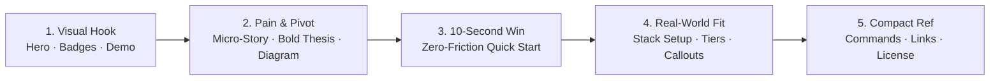

<h1 align="center">delightful-readme</h1>

<p align="center">
  <b>An agent skill that turns GitHub READMEs into visually sharp, pleasurable 2-minute reads — combining flagship landing-page polish with UX-driven narrative flow.</b>
</p>

<p align="center">
  
  
  
  
</p>

<br>

---

## The README Trap Every Maintainer Hits

You finish building a tool you're genuinely proud of. Then comes the README, and it usually falls into one of two traps.

Either you ship a barebones stub with a vague one-liner (*"A powerful, flexible tool"*) and an install command buried at the bottom — or you ask an AI to "make it look professional," and it spits out a robotic pitch deck drenched in `🚀 ✨ 🔥`, cold feature matrices, and walls of dense text nobody enjoys reading.

Both fail for the same reason: **they treat a README as a spec dump instead of a human reading journey.**

**`delightful-readme` teaches your AI coding agent how to craft READMEs that look crisp above the fold and feel effortless to read from top to bottom.**

Instead of jumping straight into dry feature checklists, every generated README follows a 5-beat reading arc grounded in UX psychology and flagship open-source patterns:



- **Visual polish without AI slop:** Centered hero framing, `flat-square` data badges, above-the-fold Hero Demos, GitHub-native Mermaid diagrams, and `<br>` breathing room — with zero hype emojis (`✨ 🚀 🔥 🎉`).
- **Narrative empathy before specs:** Opens with a relatable 2–3 paragraph scenario in second person (*"You build X..."*) and pivots with a single bold thesis line before showing architecture.
- **Zero-friction activation:** Frames Quick Start around immediate payoff (*"Try It in 10 Seconds"*) and explicitly disarms hesitation (no API keys, no signup, `#`-commented commands).
- **Alternating visual cadence:** Cycles cleanly between short prose, bold pivots, diagrams, bold-lead-in bullets, code blocks, `>` blockquote callouts, and compact tables so the eye never fatigues.

<br>

---

## Try It in 10 Seconds (Zero Config)

Works out of the box with **Antigravity**, **Claude Code**, **Cursor**, **OMP**, or any tool supporting the Agent Skills standard:

```bash
# Install via skills.sh / Vercel Agent Skills
npx skills add PramaAditya/delightful-readme

# Or clone directly into your agent's skills directory
git clone https://github.com/PramaAditya/delightful-readme.git ~/.agents/skills/delightful-readme
```

Then open any repository and ask your agent:

> *"Redesign this repo's README using delightful-readme — inspect the codebase first so every command, architecture flow, and claim is accurate."*

<br>

---

## What the Skill Enforces

`delightful-readme` pairs two layers that rarely show up together in README generators:

| Layer | What It Guarantees |
| :--- | :--- |
| **Visual Hierarchy** | Centered hero, `flat-square` data badges (3–5 max), Hero Demo above the fold, `<br>` section breathing room, native Mermaid `flowchart LR` |
| **UX & Reading Flow** | Relatable problem micro-story, standalone bold pivot, Dual-Coding mental model, friction-disarming Quick Start, progressive disclosure |
| **Tone & Honesty** | Peer-to-peer engineering voice, transparent limits/fallbacks, verified numbers over empty adjectives, zero begging filler |
| **Ruthless Scope** | Comfortable ~140–240 line 2-minute read; deep wikis, FAQs, full directory trees, and exhaustive flag dumps linked out to `docs/` |

> **Codebase-first workflow:** The skill instructs your agent to inspect `package.json`, `pyproject.toml`, `Cargo.toml`, `go.mod`, CLI entrypoints, `.env.example`, and existing assets *before* asking a single question — and never fabricate benchmarks or fake screenshots.

<br>

---

## What's Inside

| File | Purpose |
| :--- | :--- |
| [`SKILL.md`](SKILL.md) | Complete workflow, Visual + Narrative Arc skeleton, UX & style discipline, and self-audit checklist |
| [`references/readme-patterns.md`](references/readme-patterns.md) | Pattern library: 5-beat reading arc, visual decision tree, cadence rules, hard anti-patterns, and benchmark one-liners |
| [`LICENSE`](LICENSE) | MIT license |

<br>

---

<p align="center">
  <a href="SKILL.md">Skill Spec</a> · <a href="references/readme-patterns.md">Pattern Library</a>
</p>

<p align="center">
  <sub><a href="LICENSE">MIT License</a></sub>
</p>
