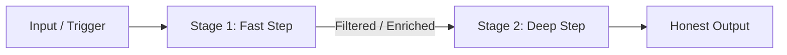

# Delightful README Generator

Turn any repository's `README.md` into a visually sharp, deeply readable open-source landing page — combining the visual polish of flagship repositories with UX-driven narrative flow and low cognitive load.

**Core thesis:** A README is both a **high-signal visual landing page** and a **pleasurable 2-minute reading journey**. Visual polish earns the first 5 seconds; narrative empathy, progressive disclosure, and zero-friction momentum carry the reader to `install` and `star`.

## Workflow

### Step 0: Inspect First, Ask Only What's Missing
If working inside an existing repository, **read the codebase first** (`package.json`, `pyproject.toml`, `Cargo.toml`, `go.mod`, existing `README.md`, `LICENSE`, CLI entrypoint, existing screenshots/assets, `PLAN.md`, `CONTRIBUTING.md`, `.env.example`) before asking anything.

Only ask the user for what cannot be inferred (max 4 questions at a time):
- **Must-haves:** Project name, one-line positioning (what it is, what pain it solves, who it's for), the concrete "before" pain scenario, and single-command zero-friction install/run.
- **High-leverage extras:** Real demo output/screenshot/GIF path, concrete numbers or competitor comparison (benchmarks, size, speed, coverage), integration/provider tiers, live docs URL, license (default MIT if unspecified).

### Step 1: Load the Pattern Library
Read [references/readme-patterns.md](references/readme-patterns.md) before drafting so visual choices, reading-flow psychology, and anti-patterns stay consistent.

### Step 2: Draft Using the Visual + Narrative Arc Skeleton
Treat this as the structural spine. Every section answers the exact question the reader naturally has at the end of the previous section. The **Style, UX & Discipline Rules** below always take precedence.

````markdown
<p align="center">
  <!-- Logo image or compact <samp> mini-demo -->
</p>

<h1 align="center">Project Name</h1>

<p align="center">
  <b>[One-line value proposition — sharp, concrete, zero fluff]</b>
  <br>
  [Optional 1-line supporting positioning]
</p>

<p align="center">
  <!-- shields.io flat-square badges: real project data badges + essential status/license -->
</p>

<br>

---

<!-- HERO DEMO: Real terminal output (with box-drawing if CLI), screenshot, or short GIF.
     Readers should see what the tool looks like and outputs BEFORE installing. -->

<br>

---

## [Relatable Problem Heading — e.g., "The [X] Trap Every Builder Hits"]

[2-3 short paragraphs (2-3 sentences each) painting a concrete, second-person ("You...") scenario the reader immediately recognizes. Show the exact friction or failure mode of the status quo — zero hype adjectives.]

**`project-name` turns [painful workflow] into [clean, deterministic outcome].**

[1-line transition introducing the mental model:]



- **[Core advantage 1]:** Concrete explanation of *how* it works and why it matters.
- **[Core advantage 2]:** Concrete explanation (highlight real trade-offs or guardrails).
- **[Honest guarantee]:** Transparently state how failures, edge cases, or limits are handled.
- **[Zero lock-in / flexibility]:** Works out of the box, or plugs into existing stack.

<br>

---

## Try It in 10 Seconds (Zero Config)

[1-line friction-disarming reassurance — e.g., "No API keys or signup required to see how it works:"]

```bash
# Comment explaining what this command demonstrates
npx project-name ...

# Comment explaining the second, richer command
npx project-name ...
```

<br>

---

## [Real-World Workflow / Integration — e.g., "Use With Your AI Agent" or "Pluggable Providers"]

[1-2 lines explaining the mental model of how this fits into the reader's real stack.]

### 1. [First integration step]

```json
// Copy-pasteable config or code snippet
```

> [Helpful callout: zero-key alternative, OS/Windows quirk, or swap-in option]

### 2. [Optional second step or progression table]

| Layer / Tier | Zero-Key Default | Self-Hosted | Paid / BYOK |
| :--- | :--- | :--- | :--- |
| **[Layer]** | `default` | `self-hosted` | `paid` |

> *[Optional example prompt or one-line usage takeaway]*

<!-- Optional: Quantified Benchmark / Head-to-Head (only when real numbers exist; <= 4 cols x 5 rows) -->

<br>

---

## [Compact Reference — e.g., "CLI & API Reference"]

| Command / Method | Description |
| :--- | :--- |
| `cmd a` | Concise purpose |
| `cmd b` | Concise purpose |

Common flags / options: `--flag-a`, `--flag-b`, `--format table|markdown|json`.

<br>

---

## Development & Contributing

[1-line note on test/engineering discipline if noteworthy.]

```bash
npm install && npm test
```

- Architecture & design: [`PLAN.md`](PLAN.md)
- Contributing guide: [`CONTRIBUTING.md`](CONTRIBUTING.md)
- Security policy: [`SECURITY.md`](SECURITY.md)

<br>

---

<p align="center">
  <a href="docs-url">Docs</a> · <a href="README.id.md">Bahasa Indonesia</a> · <a href="other-url">Changelog</a>
</p>

<p align="center">
  <sub><a href="LICENSE">MIT License</a></sub>
</p>
````

---

## Style, UX & Discipline Rules

### 1. Visual Polish (Keep the Fancy Stuff Crisp)
- **Centered hero framing:** Use `<p align="center">` for the logo/`<samp>`, `<h1 align="center">`, bold one-liner, badge row, and footer links. Avoid complex HTML layout grids.
- **Hero Demo above the fold:** Place a real terminal output (with box-drawing if CLI), crisp screenshot, or short GIF right after the hero header and *before* prose or install blocks. If no real visual exists yet, skip the placeholder — never fake a screenshot.
- **Breathing room (`<br>`):** Add `<br>` before major `---` dividers. GitHub's default vertical rhythm is cramped; whitespace makes long-form reading effortless.
- **Native Mermaid diagrams (`flowchart LR`):** Prefer GitHub-native `mermaid` flowcharts (or a 3-5 line ASCII flow `──→`) to visualize pipelines, funnels, or architecture cleanly. Never dump 30-line directory trees.
- **One language per file:** Split multilingual READMEs into separate files (`README.md`, `README.id.md`, `README.zh.md`) linked from the top or footer. Never stack two languages in one file.

### 2. Reading Flow & UX Psychology (Make It Pleasurable)
- **Narrative empathy before specs (Motivation first):** Don't hit a cold reader with a dry feature list or benchmark table right after the hero. Open with a 2-3 paragraph relatable micro-story in second person (*"You build X... Then Y happens..."*) so the reader feels recognized before seeing the solution.
- **The standalone bold pivot:** End the problem story with one crisp, standalone bold thesis sentence (`**project turns X into Y.**`). It creates an instant cognitive shift from pain to relief.
- **Dual-coding mental models:** Pair the thesis pivot with a clean `mermaid` diagram + 3-4 bullets with **bold lead-ins**. Visual + short structured text beats a dense explanation every time.
- **Disarm activation energy (Ability first):** Frame Quick Start around immediate, low-risk payoff (*"Try It in 10 Seconds (Zero Config)"*). Explicitly state what is *not* needed (no API keys, no account, no config) right above the first copy-pasteable `#`-commented code block.
- **Progressive disclosure & information scent:** Sequence the page so each section naturally answers the next question in the reader's mind:
  1. *What is this & what does it look like?* (Hero + Demo)
  2. *Why does this problem matter & how does this solve it?* (Micro-story → Bold Pivot → Diagram → 3-4 Bullets)
  3. *Can I try it right now with zero friction?* (10-Second Zero-Config Quick Start)
  4. *How does it fit into my real stack / grow with me?* (Integration steps, Free → Self-Hosted → BYOK table, `>` edge-case callouts)
  5. *What's the quick reference & where do I go deeper?* (Compact command table + Dev/Doc links + License)
- **Visual cadence (never repeat the same texture twice):** Alternate short paragraphs (2-3 sentences max), standalone bold punchlines, diagrams, bold-lead-in bullets, commented code blocks, `>` blockquote callouts (for tips, Windows notes, example prompts), and compact tables.
- **Radical honesty & peer voice (Ethical UX):** Write like a sharp engineer talking to peers, not a press release. State real boundaries, fallbacks, and honest trade-offs transparently (e.g., *"marks it `UNVERIFIED` — never `CLEAN`"*). Replace empty hype (*"fast, modern, scalable"*) with real mechanisms or verified numbers. Cut begging filler (*"Contributions welcome!"*, *"Feel free to open an issue"*).

### 3. One-Line Golden Formula
```text
[Project] — [concrete action/category] for [target user] across/with [specific scope or differentiator].
```
- Bad: *"A powerful, modern framework built with love."* (Empty.)
- Good: *"Lint your product and open-source names before you ship — across Google SERPs, domains, GitHub, and package registries."*
- Good: *"Crawl4AI turns the web into clean, LLM-ready Markdown for RAG, agents, and data pipelines."*

### 4. Ruthless Cuts & Length Discipline
Move these to `docs/` or dedicated repo files instead of bloating the README:
- Full directory trees (if needed at all, cap at 5-8 key files)
- Exhaustive CLI flag / API reference docs (keep a compact 4-6 row summary table + 1-line common flags)
- Long grading/methodology/scoring matrices (summarize in 1 line and link out)
- FAQs (never put FAQ blocks in the README)
- Full contributing guides (link to `CONTRIBUTING.md`)

**Target length: ~140–240 lines (a comfortable 2-minute read).** Prioritize low cognitive load and smooth reading rhythm over a rigid line-count cliff — never strip out the relatable problem story or `<br>` breathing room just to squeeze under a number, and never pad with filler.

### 5. Badges
- Use `shields.io` with `?style=flat-square`.
- **Data badges > status badges:** Show concrete proof of what the project contains or achieves (e.g., `bundle-4.2KB-brightgreen`, `zero_config-true-blue`, `providers-7-purple`) alongside version/license.
- Keep it to 3-5 sharp badges — don't pad a repo with 8 empty status badges.

### 6. Emoji Discipline
- **Allowed (functional markers only):** `✓`, `✗`, `✅`, `⚠️`, `📖` — max 1 per bullet or row.
- **Forbidden (decorative hype):** `✨`, `🚀`, `💪`, `🔥`, `⭐`, `🎉`. They instantly make a repo look AI-generated.

---

## Step 3: Self-Audit Checklist

Verify every item before finalizing:
- [ ] Centered visual hero (logo/`<samp>`, title, concrete one-liner, 3-5 `flat-square` badges) + Hero Demo above the fold (when a real visual/output exists)
- [ ] Opens with a relatable, concrete problem micro-story → standalone bold thesis pivot → `mermaid` (or ASCII) mental model → 3-4 bold-lead-in bullets
- [ ] Quick Start disarms friction explicitly (*"Try It in 10 Seconds"*, zero-config reassurance) with `#`-commented, copy-pasteable commands
- [ ] Sections follow progressive disclosure (Simple → Integrated/Configurable → Compact Reference → Links) with `<br>` breathing room before major `---` dividers
- [ ] Visual textures alternate naturally (short prose, bold pivot, diagram, bullets, code, `>` callouts, compact tables) — zero walls of text
- [ ] Honest, peer-to-peer engineering tone (real limits/fallbacks stated plainly; zero empty adjectives or fabricated benchmarks)
- [ ] Zero bare URLs (every link has descriptive anchor text) and zero decorative hype emojis (`✨ 🚀 🔥 🎉`)
- [ ] Deep docs, FAQs, full flag dumps, and contributing guides are linked out rather than inlined
- [ ] Centered footer links + `<sub>` license at the very bottom
- [ ] Comfortable 2-minute read (~140–240 lines)

## Step 4: Redesigning an Existing README

- **Full overhaul** (*"redesign"*, *"start from scratch"*, *"this is ugly/bloated"*): Ignore the old layout completely and rebuild around the Visual + Narrative Arc above.
- **Targeted polish**: Fix the highest-impact UX & visual gaps first — dry/missing problem hook, buried or high-friction Quick Start, missing hero demo or mental-model diagram, monotonous walls of text, decorative emoji clutter, bloated reference tables, missing data badges.
- **Target outcome:** Visually crisp above the fold, effortless to read from top to bottom, and faster time-to-value.
